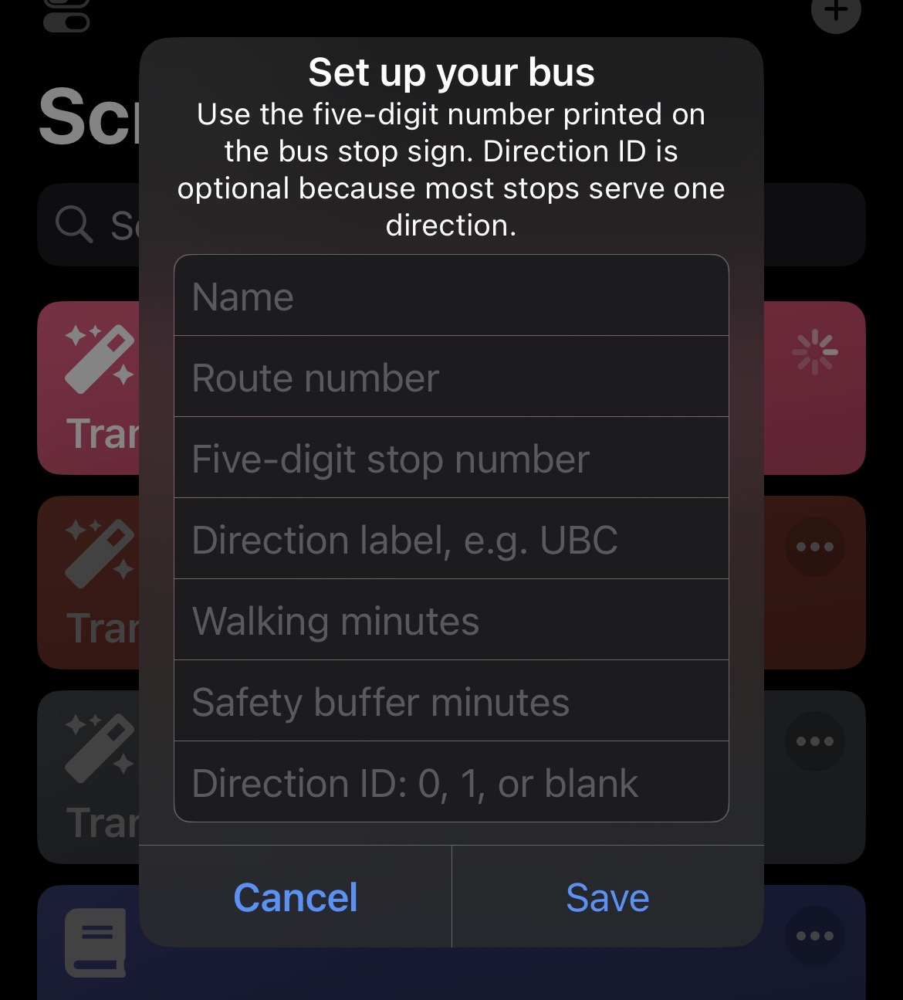
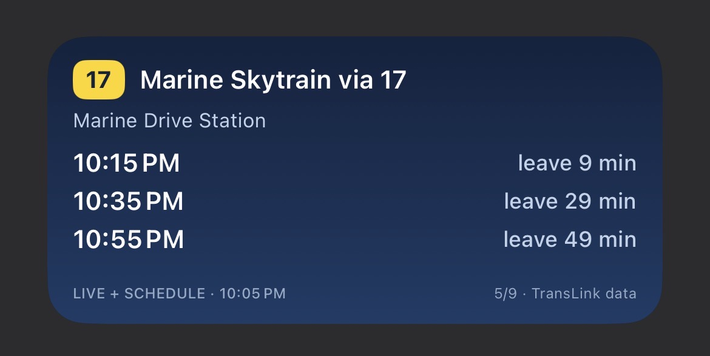

# Personal Transit Widget

A personal TransLink departure widget for the iPhone Home Screen, built with
[Scriptable](https://scriptable.app/). It does not need Xcode, an Apple Developer
membership, App Store review, or weekly re-signing.

The widget answers one small question:

> Which of my regular buses can I realistically catch, and when should I leave?

## Why did I build this?

I don't take public transit very often, but when I do, it's usually to familiar places like UBC, work, or a SkyTrain station. For these trips, I tend to take the same routes - the 49, the R4 etc.

Yet every time I'm about to leave, I still find myself opening Google Maps or a transit app just to check when the next bus arrives.

It's a small inconvenience, but one I thought could be avoided. Instead of opening an app and searching for the same route every time, what if I could just glance at my lock screen and know when to leave?

That's the idea behind this project.

## Preview

<table>
  <tr>
    <td align="center" valign="middle" width="50%">
      
    </td>
    <td align="center" valign="middle" width="50%">
      
    </td>
  </tr>
  <tr>
    <td align="center"><strong>Set up a saved bus</strong><br><sub>Add the route, stop number, and optional direction details.</sub></td>
    <td align="center"><strong>See when to leave</strong><br><sub>Check upcoming arrivals and catchable leave times at a glance.</sub></td>
  </tr>
</table>

## MVP features

- Centrally adds, edits, removes, and switches between any number of saved buses
- Uses TransLink's supported GTFS-Realtime v3 feed
- Combines realtime predictions with scheduled fallback for the bundled personal stops
- Accepts the familiar route number and five-digit number printed on the stop sign
- Shows the scheduled or predicted clock time for the next two or three catchable buses
- Calculates `leave in` from walking time plus a safety buffer
- Filters short-turn trips with an optional destination keyword
- Caches the last successful result and clearly marks cached or stale information
- Stores the TransLink API key in the iPhone Keychain, not in the repository
- Supports Home Screen and Lock Screen Scriptable widgets
- Offers active-bus, automatic most-urgent, and multi-bus dashboard modes

## What you need

1. An iPhone with [Scriptable installed](https://apps.apple.com/app/scriptable/id1405459188).
2. A personal [TransLink Open API key](https://www.translink.ca/about-us/doing-business-with-translink/app-developer-resources/register).
3. These three files from the [`scriptable`](./scriptable) folder:
   - `TransitWidget.js`
   - `TransitWidgetCore.js`
   - `TransitWidgetData.js`

## Install on your iPhone

### 1. Copy the scripts

Copy all three JavaScript files into the same Scriptable folder under either
**On My iPhone** or iCloud Drive.
The files must keep their original names because the main script imports the other
two by name.

If your Mac and iPhone use the same iCloud account, the easiest path is:

```text
iCloud Drive/
└── Scriptable/
    ├── TransitWidget.js
    ├── TransitWidgetCore.js
    └── TransitWidgetData.js
```

### 2. Complete the one-time setup

Open Scriptable and run **TransitWidget** once. The central manager lets you add,
edit, remove, or switch between saved buses. Each saved bus includes:

- Your TransLink API key
- A short name such as `To campus`
- The route number, such as `49`
- The five-digit stop number printed on the bus stop sign
- An optional direction label, such as `UBC`
- Walking time
- Safety buffer
- An optional GTFS direction ID (`0` or `1`)
- An optional destination keyword such as `UBC` or `Metrotown`

Most physical stops serve one direction, so leave the direction ID blank unless
the widget shows trips for both directions. Use a destination keyword when a route
has short-turn trips that do not reach the desired destination.

The API key is stored in the iPhone Keychain. It is never added to a script or
written into the Git repository.

### 3. Add the Home Screen widget

1. Long-press an empty area of the Home Screen.
2. Choose **Edit → Add Widget**.
3. Find **Scriptable** and select a small or medium widget.
4. Long-press the new widget and choose **Edit Widget**.
5. Set **Script** to `TransitWidget`.
6. Choose a display mode in **Parameter**:

   - Leave empty to show the active bus selected in Scriptable.
   - `auto` to show whichever saved bus has the most urgent leave time.
   - `all` in a medium widget to show up to three saved buses together.
   - `favorite:Home via 49` to pin one saved bus by name.

You can now check departures without opening Scriptable. Tapping the widget opens
the TransLink schedule page for the configured stop.

## Manage saved buses

Run `TransitWidget` inside Scriptable to open the manager. It provides actions to:

- Preview the active bus
- Switch the active bus
- Add another bus
- Edit or remove the active bus
- Update the API key

The empty-parameter Home Screen widget follows the active selection. Scriptable
does not provide true interactive next/previous controls inside a widget, so
switching manually opens the central manager. The `auto` mode avoids manual
switching by selecting the most urgent saved bus whenever the widget refreshes.

For backwards compatibility, a widget can still contain an ad-hoc pipe-separated
configuration:

```text
To campus|49|61218|UBC|0|0|1|UBC
```

The fields are:

```text
name|route|stop number|direction label|walking minutes|buffer minutes|direction ID|destination keyword
```

Direction ID is optional. The same configuration can also be supplied as JSON:

```json
{
  "name": "To campus",
  "route": "49",
  "stopCode": "50001",
  "direction": "UBC",
  "walkingMinutes": 7,
  "bufferMinutes": 2,
  "directionId": 1,
  "headsignContains": "UBC"
}
```

Every widget uses the same API key stored during the one-time setup.

## Lock Screen

On iOS 16 or later, add a Scriptable widget to the Lock Screen and select
`TransitWidget`. Inline, circular, and rectangular layouts are supported. The same
parameter modes work, although `auto` or one named favourite fits best in the
limited Lock Screen space.

## Refresh behaviour

The script asks iOS to refresh after ten minutes, but iOS ultimately decides when
Home Screen widgets run. The footer always shows whether the result came from the
live feed, the local cache, or is stale, along with the last successful update time.

TransLink currently allows up to 1,000 API requests per day per key. A single widget
requesting a ten-minute refresh stays well below that limit, but iOS timing and
multiple widget instances can change the actual total.

## Development

No dependencies are required. Run the pure JavaScript tests with:

```bash
npm test
```

`TransitWidgetData.js` contains a generated lookup from public stop and route labels
to internal GTFS identifiers. It also contains compact scheduled fallback data for
the stops listed in `data/schedule-stops.json`. To rebuild it from TransLink's latest
static feed:

```bash
curl -sS https://gtfs-static.translink.ca/gtfs/google_transit.zip \
  -o /tmp/translink-google-transit.zip
npm run update-data -- /tmp/translink-google-transit.zip
```

Commit the regenerated `scriptable/TransitWidgetData.js` file. Do not commit an API
key or personal local configuration.

## Extended Features
- Sometimes I can take either the 10 or 100 (same stop). An extended feature would be being able to group buses, merging their schedules together
- More customer-friendly UI; easier ways to add, remove, edit 
- Refreshing is dependent on IOS so could be a little delayed and not fully synchronized
- The widget itself is under **Scriptable** and not on the **App Store**
## TransLink data attribution

Route and arrival data used in this product or service is provided by permission of
TransLink. TransLink assumes no responsibility for the accuracy or currency of the
Data used in this product or service.

See TransLink's [developer resources](https://www.translink.ca/about-us/doing-business-with-translink/app-developer-resources)
and [terms of use](https://www.translink.ca/about-us/doing-business-with-translink/app-developer-resources/terms-of-use).
